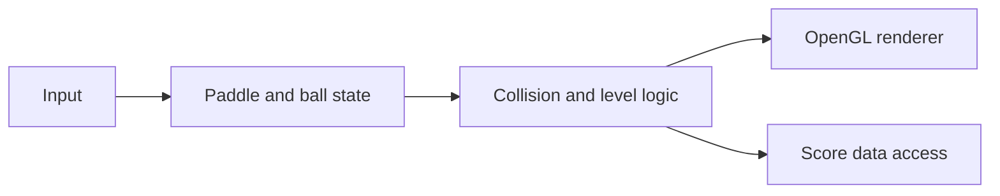

# Brick Breaker | C++ and OpenGL

**A modular arcade-style Brick Breaker project built with C++, OpenGL and a Visual Studio solution.**

[Browse source](8-2_Assignment/) · [Visual Studio solution](8-2_Assignment/8-2_Assignment.sln) · [Portfolio](https://xtyledan.github.io/)

## Project at a glance



*Source-architecture illustration. This is not a captured game screenshot.*

## Why it exists

The project applies modular design and graphics programming to a familiar game: move a paddle, keep the ball in play, and clear bricks. The repository contains C++ source files for scene elements, collision behavior, input and data access.

## Explore the implementation

| Area | Code |
| --- | --- |
| Entry point / rendering | [MainCode.cpp](8-2_Assignment/Source/MainCode.cpp) |
| Paddle and ball | [Paddle.cpp](8-2_Assignment/Paddle.cpp), [Circle.cpp](8-2_Assignment/Circle.cpp) |
| Collision handling | [Collision.cpp](8-2_Assignment/Collision.cpp) |
| Bricks, grid and levels | [Brick.cpp](8-2_Assignment/Brick.cpp), [Grid.h](8-2_Assignment/Grid.h), [Level.h](8-2_Assignment/Level.h) |
| Data access | [DataAccess.cpp](8-2_Assignment/DataAccess.cpp) |
| Project configuration | [8-2_Assignment.sln](8-2_Assignment/8-2_Assignment.sln), [8-2_Assignment.vcxproj](8-2_Assignment/8-2_Assignment.vcxproj) |

## Build / review locally

This repository contains a **Visual Studio solution**, not a verified cross-platform CMake build.

1. Clone the repository and open `8-2_Assignment/8-2_Assignment.sln` in Visual Studio.
2. Inspect project properties and configure the required OpenGL, GLFW, GLEW and SQLite include/library paths for your machine.
3. Use an appropriate Windows C++ toolchain, configure runtime DLLs if needed, then build the selected solution configuration.
4. Run the executable only after the dependencies are correctly resolved.

```bash
git clone https://github.com/xtyledan/C-OpenGL-Brick-Breaker-CS499.git
cd C-OpenGL-Brick-Breaker-CS499
```

**Intended controls:** Arrow keys move the paddle, Space launches the ball, P pauses, and Escape exits. Actual behavior depends on a successful local build.

## Design choices and verification

Keeping collision logic, entities, input and data access separate makes the code easier to inspect than a single monolithic implementation. The tradeoff is more build configuration and dependency management.

**Not verified here:** A clean build on a fresh machine, a working Windows game capture, SQLite persistence, GoogleTest execution, CI or cross-platform compilation. Some generated IDE files are already tracked; [.gitignore](.gitignore) prevents future build artifacts but does not remove historical tracked files.

This is an educational source project, not a hosted game or confirmed downloadable release. [More verified projects](https://github.com/xtyledan).
